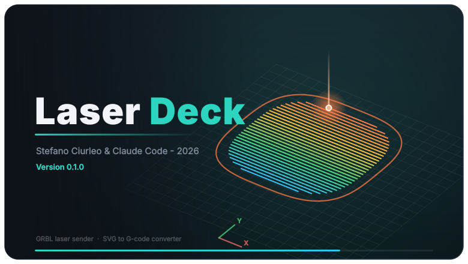
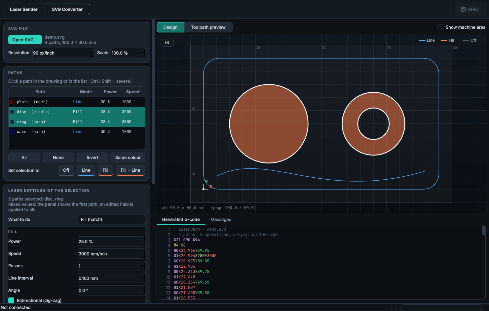
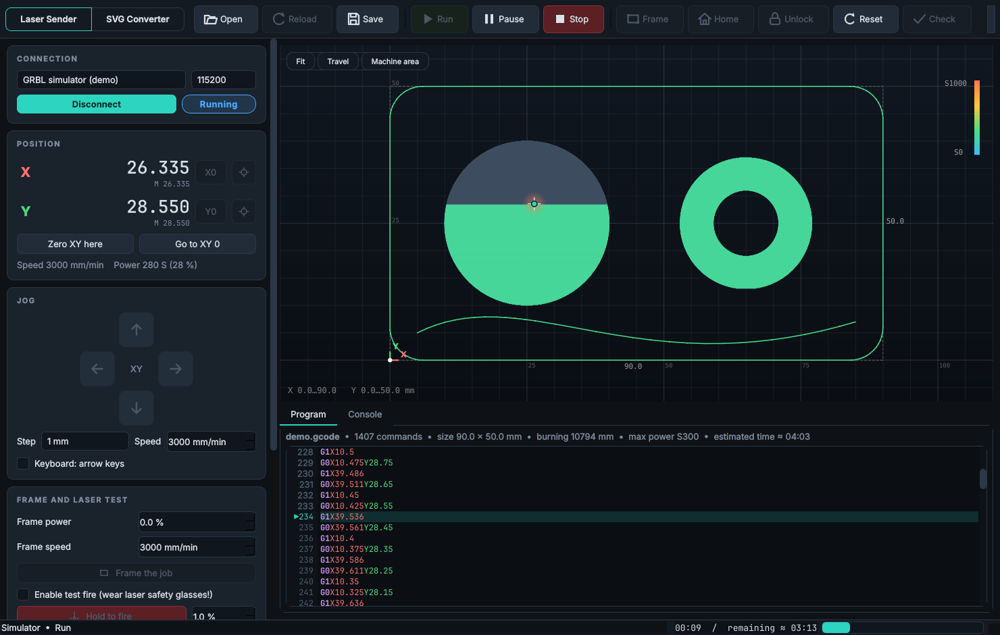

# Laser Deck

<p align="center"></p>

G-code sender and **SVG → laser G-code** converter for **GRBL 1.1 laser engravers** (designed for the Longer Ray5 mini, works with any
GRBL 1.1 machine in laser mode) with a dark interface. Same technology and look as [CNC Deck](https://github.com/stefanolmo/cncgrbl):
Python 3 + Qt6 (PySide6) + pyserial, `pyclipper` for the geometry, `svgelements` for the SVG, the same serial engine
(character-counting streaming) and the same built-in GRBL simulator.

## What it is

A single window with two modes, selected with the switch at the top left.

**SVG Converter** – load an `.svg` and decide, **for every single path**, what the laser does: *Off*, *Line* (outline), *Fill* (hatch) or
*Fill + Line*, each with its own power, speed and passes. Select paths in the list or by clicking them in the drawing, change a field
and it is applied to all the selected ones. The toolpath preview is coloured by laser power. Then save the `.gcode` or press
**Send to Laser** to load it straight into the Sender.

<p align="center"></p>

**Laser Sender** – connect the laser, set the work zero with the jog pad, **frame** the job, and stream the G-code with a live 2D view
(burned part in grey, laser head, power colours).

<p align="center"></p>

## Installation (Ubuntu)

```bash
./install.sh          # venv in ~/.local/share/laserdeck, "laserdeck" launcher, menu entry
laserdeck             # or: laserdeck examples/demo.svg   /   laserdeck examples/demo.gcode
laserdeck --sim       # try everything without a machine (built-in GRBL simulator)
laserdeck --no-splash # skip the 3 second splash screen (or LASERDECK_NO_SPLASH=1)
```

Without installing: `pip install -r requirements.txt && python3 -m laserdeck`.

**Serial port on Ubuntu** (the classic causes of "I cannot see the port"):
- your user must be in the `dialout` group: `sudo usermod -aG dialout $USER`, then log out and back in;
- `brltty` steals CH340 boards (the Ray5 uses one): `sudo apt remove brltty`.

The Ray5 talks GRBL 1.1 at **115200 baud**; it appears as `/dev/ttyUSB0`.

## SVG → G-code converter

For each path (SVG shape) you choose:

| What to do | Result |
|---|---|
| **Off** | the path is ignored |
| **Line** | the laser follows the outline (open paths too): power, speed, passes, optional **offset** (kerf compensation: + outward, − inward) |
| **Fill** | scan-line hatch of the inside, using the SVG fill rule (holes stay empty): power, speed, passes, **line interval**, **angle**, bidirectional or one-way, **cross-hatch**, **overscan** |
| **Fill + Line** | both, each with its own power/speed (for example engrave a shape, then outline it) |

- Defaults are suggested from the SVG style: stroke only → *Line*, fill only → *Fill*. Everything can be changed afterwards.
- **Select** by clicking in the drawing (Ctrl/Shift = several), in the list, *All / None / Invert*, or *Same colour* (all the paths with the colour of
  the selected ones). A field edited with several paths selected is applied to all of them.
- **Presets**: save the power/speed/fill settings of a path under a name (for example «3 mm plywood cut») and apply them to other paths.
- **Order** (like most laser software): all the fills first, the lines last, inner contours before outer ones, nearest-neighbour travel.
  Passes of a group run one after the other (so a thick cut does not scorch a single spot). It can be switched to «as listed in the table».
- **Job options**: S scale (the machine's `$30`, filled in automatically when connected), **M4 dynamic power** (recommended, needs `$32=1`) or M3,
  **origin** (bottom-left / top-left / centre of the design, or the SVG page = position on the bed), air assist (`M8`/`M9`), return to X0 Y0.
- The generated G-code goes through the same parser and streaming as the Sender: the tests send it to the GRBL simulator and check that
  it runs without errors and that the laser never fires during a rapid move.

Generated G-code looks like this (laser mode, power only changes when needed, coordinates only when they change):

```gcode
G21 G90 G94
M4 S0
G0X23.966Y39.95
G1X25.994S250F3000
G0X26.975Y39.85
G1X22.986
...
M5
G0X0Y0
M2
```

**Coordinates.** Machine Y points away from you, so the design is flipped from the SVG (y down): the top of the drawing is +Y. With the default
origin *bottom-left of the design*, put the laser head where the bottom-left corner of the job must be, press **Zero XY here**, then **Frame**.

Not implemented: raster images (greyscale/dithered engraving), text (convert it to paths: Inkscape *Path → Object to Path*), saving per-path settings
inside a project file.

## Laser Sender

| | |
|---|---|
| Streaming | *character-counting* protocol (127-byte RX buffer), no pauses between lines; pause = feed hold `!`, stop = hold + soft reset |
| 2D view | pan (drag), zoom (wheel), double-click = fit; colour by power, already burned part in grey, live laser head, machine area (needs homing) |
| Program | editor with highlighting, running line, time estimate (also remaining, corrected for the override), warnings |
| Resume | right-click a line → *Start from line…*: restores units/speed/laser mode with the laser **off**, moves, then continues |
| DRO / Jog | work and machine coordinates, **Zero XY here**, go to zero, jog 0.1–50 mm or continuous (stops at once on release), optional keyboard |
| **Frame** | traces the bounding box of the job at 0 % (head moves, laser off) or a faint pointer power (1–3 %, laser mode only) |
| **Test fire** | «Hold to fire» at a low power: the laser is on only while the button is pressed; it must be enabled first with a checkbox |
| Override | speed, rapids, power (real-time commands) |
| Safety checks | warning bar and one-click fix if laser mode `$32` is off (GRBL would keep the laser on during rapids and burn the material); confirmation before a run if `$32=0`, if the file uses more power than `$30`, or never switches the laser on |
| Other | unlock, reset, check mode, console with history, `$$` editor with descriptions, 6 custom macros, drag & drop of `.svg` and `.gcode` files |

Homing is only enabled if the board reports `$22=1` (the Ray5 has no limit switches: you zero the work position by hand).

## Laser safety

A laser can blind and start fires. Wear the **laser safety glasses** matching your module, never leave a running job unattended, keep a
fire extinguisher and good ventilation at hand, and keep the **emergency stop** (the Stop button is a soft stop; unplug power if in doubt).
Always **frame** the job and do a first run on scrap, at low power, before the real material.

## Development

```bash
pip install -e .[dev]
python -m pytest            # tests: parser, CAM (fill, order, origins, kerf), streaming against the simulator, offscreen UI
QT_QPA_PLATFORM=offscreen python3 docs/make_screenshots.py   # regenerate the README images
```

`laserdeck/simulator.py` emulates a GRBL 1.1 laser (127-byte RX buffer, 15-block planner, laser mode `$32`, hold/jog-cancel,
overrides, 400 × 400 mm) and is used by the `--sim` mode and by the tests, which check that streaming never exceeds the RX buffer
and that the laser never burns during G0 when `$32=1`.

**Important**: everything was tested on the simulator, not on a real Ray5 mini. The first time on the real machine, do a dry run (*Check mode*
or *Frame* at 0 %), without material and with a hand on the power switch.
